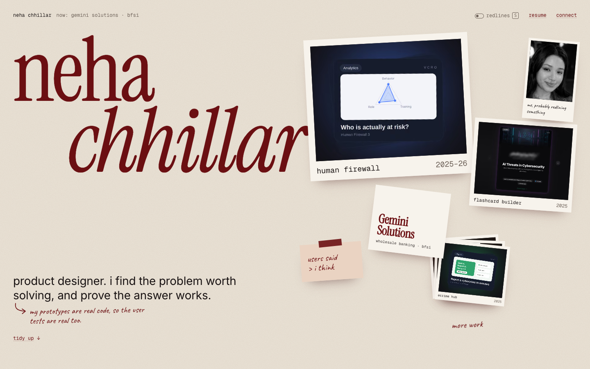

# nc-designs

My portfolio, designed and built by me.

**Live: [nc-designs.vercel.app](https://nc-designs.vercel.app)**

<p align="center">
  
</p>

Five case studies (Human Firewall, Flashcard Builder, eCrime Hub, unsaid, Airtel Travel Mode), two essays, a resume and a work-with-me page, laid out like a designer's desk: paper, prints, redlines you can toggle with the S key. Each case study is its own route, and its content lives in a typed data file, so the story can change without touching layout code.

The previous design is archived in git: the tag `v1-final` and the branch `archive/v1`.

## Built with

Next.js 16 (App Router), React 19, TypeScript, Tailwind CSS 4, Motion, Vercel (hosting, Blob, Analytics). Built with Claude Code as a pair programmer.

## How it's organised

```
app/(site)/       The public pages: home, /case-study/*, /writing/*, /resume, /work-with-me
app/stats, api/   The private reading-time page and its endpoints
components/
  home-v2/        The shell (top bar, footer, spec mode) and the homepage desk
  v2-case-study/  Shared case-study pieces (chapters, prints, decision sets, switches) and one folder per study
  ui/             The custom cursor and its context
data/             Content for every page as typed TypeScript
lib/              Site config, SEO and structured data, redirects, hooks
design-system/    The written design system: pages/home-v2.md and pages/case-study-v2.md
scripts/          Preview-card generator, signature builder, and site-check (the test suite)
docs/             Screenshots for this README
```

## Design decisions in code

- **One written source of truth.** `design-system/neha-portfolio/pages/home-v2.md` and `case-study-v2.md` record the tokens (paper, oxblood, Instrument Serif, Geist Mono), the grid, the motion rules and the voice.
- **Every page is checked.** `scripts/site-check` runs layout at four widths, the interactions, a repeated-claims check and length, against a running server.
- **Content is data.** Case studies read from `data/*.ts`, so a copy edit never risks a layout change.
- **Motion respects the user.** A global `prefers-reduced-motion` rule plus a `use-reduced-motion-safe` hook tone animations down for anyone who has asked their OS for less motion.
- **One place for the domain.** `lib/site.ts` holds the site URL, and the sitemap, robots, canonical links and OG tags all derive from it.

## Run it locally

```bash
npm install
npm run dev     # http://localhost:3000
npm run build
node scripts/site-check/layout.mjs unsaid   # with the dev server running
```
